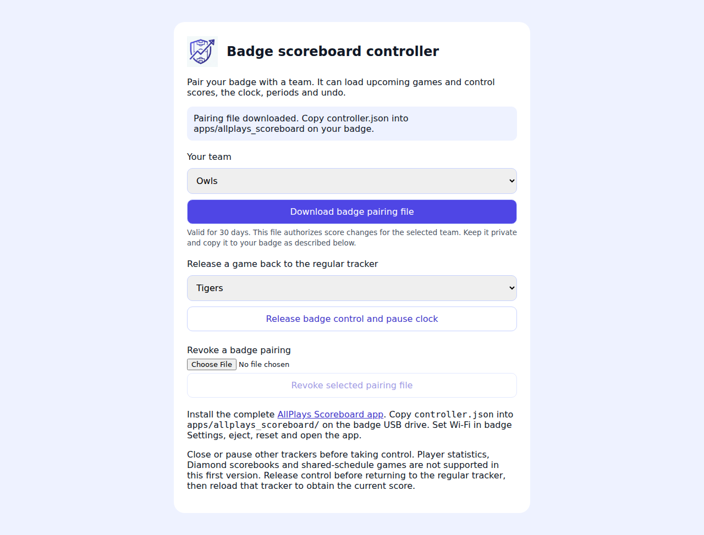

# Badge scoreboard controller

The Universe 2026 badge controls one team's ordinary AllPlays games over Wi-Fi. Version one has team/opponent +1/-1, count-up Start/Pause, period selection and a 30-action undo history. It intentionally does not record player statistics or finalize games. Uses the existing AllPlays logo and indigo colors.

Badge code and complete USB installation steps: [paulsnidernet/badge-apps/apps/allplays_scoreboard](https://github.com/pauljsnider/paulsnidernet/tree/main/badge-apps/apps/allplays_scoreboard).

## Setup and handoff

Deploy this PR through the normal master release workflow before installing/pairing a badge. It adds `configureBadgeScoreController` (authenticated callable), `badgeScoreController` (HTTPS), the matching Firestore rules, and `/badge-controller.html`. The existing release workflow deploys changed rules before application components. No old client permission changes until a manager explicitly claims a game with the new server. There are no new indexes or npm dependencies.

At `/badge-controller.html`, a signed-in verified team manager selects a managed team and downloads `controller.json`. The browser generates a 256-bit capability and retries setup using the same token after an uncertain answer. Only its SHA-256 hash is stored as the device document ID. Copy the private file and the complete badge app folder to the USB drive, save Wi-Fi in badge Settings, then launch. The badge synchronizes NTP and uses verified TLS with bundled public Google CA roots. Firmware that lacks verified TLS is unsupported; there is no insecure fallback.

The badge lists at most 60 games from yesterday through the next 14 days. Practices, completed/cancelled/deleted games, Diamond v2, shared schedules and legacy shared games are excluded. Pause and close the normal tracker, choose a game, and take control. `Us` always means the managed team, consistent with the existing homeScore/awayScore storage contract. Period choices pause the clock without resetting elapsed time. Undo does not rewind elapsed time.

Select Games > Release to pause and hand control back; reload the regular tracker afterwards. Home exits without pausing or releasing. A manager can release a stranded game on the setup page. Revoke a pairing using its saved configuration file; release any game separately. Device grants expire after 30 days. Existing grants cannot extend themselves by retrying setup.

## API and persistence

`POST /badgeScoreController` takes a bearer device capability and a JSON action. The server reads current Firebase Auth account state and canonical team management access on every request, and rechecks the grant and team/user documents inside mutation transactions. Unverified/disabled accounts, removed roles, expired/revoked pairings and other teams fail closed. No admin SDK credential or Firebase password is installed on the badge.

- `games` returns the paired team's eligible games.
- `claim` returns a control session ID, revision, confirmed scoreboard, periods and undo availability. A running existing clock must first be paused.
- `state` refreshes the selected controlled game.
- `score`, `clock`, `period`, `undo` require `gameId`, `sessionId`, expected `revision` and a stable 128-bit `requestId`. State, history, receipt and live event commit atomically. Repeated matching IDs return current state without applying again; mismatched payloads or revisions fail.
- `release` requires the current session and pauses the clock. Repeating it after a successful release is harmless; an old session cannot release a newly claimed game.

The badge persists pending commands before transmitting and retries the identical request after response loss/reboot. It blocks further commands while uncertain. Persistence failure prevents transmission. A new control session rejects uncommitted stale commands from an old session.

Server-private collections: `badgeScoreDevices/{tokenHash}`, `badgeScoreLocks/{hash(teamId/gameId)}`, and each lock's `receipts/{requestId}`. Firestore clients cannot read or write these, including managers. Receipt history is retained across release for deduplication; there is no automatic cleanup job in this version. Grant expiry is enforced on reads, independently of document cleanup. Public games carry only `badgeScoreControl: true`, never capabilities or device IDs.

While claimed, rules deny score/clock and stat-event writes from legacy web, React web and packaged native clients. Non-score metadata remains writable. No consumer needs a new writable field; they continue reading existing game clock/score fields and live events. Returning to an already-open tracker requires a reload after release. Managers can still delete games using existing permissions.

## Verification and rollout

- Functions: `node --test functions/test/badge-score.test.cjs`.
- Portal: `npx vitest run tests/unit/badge-controller.test.js` and `tests/smoke/badge-controller.spec.js` (mocked service responses; no production mutations).
- Rules: `npm run ci:firebase-rules` and emulator-backed `tests/unit/badge-score-rules.test.js`, also added to the existing CI rules command.
- Badge: 30 Python host tests across the app collection and the official 2026 hardware static validator. Original upstream logo is 678x680, producing one non-square icon advisory.
- The existing streaming-broadcast emulator suite has six expression-budget failures on both baseline commit `1df887d4081edb1f22ae9ed80adbbb5cf0e37021` and this change. No additional failures appeared in that suite.

Physical badge, production end-to-end, actual Wi-Fi/TLS and live-viewer testing remain required after deployment. Validate score/clock on both legacy and React viewers, multiple game selection, disconnect after commit before response, reboot retry, revoke, and release/reclaim. Do not describe this source-only delivery as already deployed or hardware-tested.

### Handoff corrections

Badge events carry their source and resulting clock-running state. Legacy tracker resume restores the authoritative game scores after stat reconstruction and stale local-state restoration, preserves newer local edits, and marks the scoring log incomplete so finalization cannot discard unattributed badge points. Events before an explicit reset are ignored. Period-change events explicitly pause event-driven overlays.
